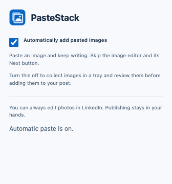

# PasteStack

Paste several clipboard images into a LinkedIn post without saving each one first.

**Cmd+V on Mac · Ctrl+V on Windows/Linux · paste and keep writing.**

By default, each paste adds images to LinkedIn, advances its image editor's Next
button, and returns focus to the post text. Further pastes join the same native
multi-image post. Images pasted during a transition are queued, so earlier files
are preserved. Publishing remains your choice.

Prefer to review first? Click the toolbar icon and turn off **Automatically add
pasted images** to use the original image tray and manual Next flow.


*The optional manual-review tray, shown in a controlled test composer.*

## Install locally

The extension is built and ready in `dist/`. You can load it directly without
installing developer dependencies. If starting from a source checkout, build it:

```sh
npm ci
npm run build
```

1. Open `chrome://extensions` in Chrome.
2. Turn on **Developer mode**.
3. Click **Load unpacked** and select this project's **dist** folder.
4. Refresh your LinkedIn tab after saving any draft you want to keep.

Alternatively, extract `artifacts/pastestack-0.2.0.zip` and load the extracted
folder. Chrome cannot load the ZIP itself. No Chrome Web Store listing exists yet.
For an existing local installation, click Reload on PasteStack's extension card,
then refresh LinkedIn after saving any draft you want to keep.

## Use

1. Open **Start a post** on LinkedIn, or visit its [post composer](https://www.linkedin.com/sharing/compose/).
2. Copy an actual image: for example, use **Copy image** in your browser, or
   **Cmd+Ctrl+Shift+4** for a clipboard screenshot on Mac / **Win+Shift+S** on Windows.
3. Click in the post editor and paste. PasteStack adds the image and returns you
   to writing automatically; neither Add to post nor Next requires a click.
4. Copy another image and paste again. It joins the same post, preserving earlier
   attachments. Pasting during a transition queues the new file.
5. Type any text you want. Review the native previews and click LinkedIn's
   **Post** button when ready.

Repeating the exact same image is allowed intentionally. Photos stay separate
attachments. Use LinkedIn's **Edit** control to crop, add alt text, remove images,
or reorder them before publishing.
When adding a later batch to an existing album, LinkedIn may insert it after the
currently selected photo. Use its native reorder controls if you want a different
order; PasteStack preserves the existing photos and leaves native ordering intact.

PNG, JPEG, and GIF are supported, up to **20 images per post**, **5 MB per image**.
Counts include native attachments when their remove controls are identifiable;
LinkedIn enforces the final combined limit. Other image formats get a message
asking you to convert to PNG. Originals are never resized or recompressed.

Text-only pastes work normally. When a clipboard contains both an image file and
text/HTML, PasteStack collects the image; paste accompanying text separately.
Copying only an image URL does not fetch or attach the image.

## Automatic or manual review

Click PasteStack's toolbar icon to change **Automatically add pasted images**.
It is **on by default**, persists on this computer, and updates open tabs without
a reload. A batch already in progress finishes using the mode it started with.



With automatic mode off, paste into the tray, review/remove images, click **Add
images to post**, and complete **Next** yourself. Use this mode when you want to
edit or add alt text before returning to the post. The extension blocks the
recognized Post button while local images are pending or being transferred.

## Lightweight by construction

- **About 17.5 KB** of content-script JavaScript, with a hard **20 KiB** budget.
  The settings popup adds about 0.6 KB of JavaScript and loads only when opened.
- **Zero runtime dependencies**. TypeScript, esbuild, Playwright, and ZIP tooling
  are development tools; none ships inside the extension.
- **No background process**, startup DOM scans, idle timers, or clipboard polling.
- One settings read at startup and a storage-change listener keep the preference
  current. A short 180 ms per-paste timer coalesces rapid pastes. Observers run
  only while files are pending; upload handoff is bounded to three seconds and
  returning through Next is bounded to fifteen seconds.
- File references and blob URLs avoid base64 copies of original images.
  Manual/error thumbnails are downsampled to 160 pixels wide and decoded one at
  a time. Automatic mode avoids decoding separate extension thumbnails.
- Original and thumbnail URLs are revoked on removal, clear, successful handoff,
  composer close, or page exit. Images are not retained as clipboard history.

Image memory still depends on your files and the browser's decoder. These are
design properties and a bundle measurement, not an assertion of a measured
CPU/RAM benchmark on every computer.

## Privacy and permissions

PasteStack runs only on **https://www.linkedin.com/**. Chrome will show site-access
permission for LinkedIn because the extension needs to integrate with the composer.
The only extension API permission is **storage**, used for one local boolean
preference. It requests no clipboardRead, tabs, or downloads permission. Images
and post text are never written to storage. It reads image files from the paste
event you initiate, without inspecting clipboard text or HTML.

There is no server, analytics, tracking, private LinkedIn API integration, or
extension-originated network request. Images live in tab memory until discarded
or handed to LinkedIn; LinkedIn's own uploader then sends them to LinkedIn.
Refreshing/navigating away or closing the composer discards a staged stack.
The extension never clicks Post or publishes on your behalf.

## Compatibility and current verification

Targets current desktop Chrome on macOS and Windows; Chromium browsers may also
work. No mobile, Safari, or Firefox support is claimed. Chrome 120 is the API
compatibility floor; use an up-to-date browser.

**Automated verification:** 39 browser tests passed locally on macOS using the
actual Manifest V3 extension loaded in Playwright's bundled Chromium. Coverage
includes a real OS clipboard paste via Cmd+V, real FileList/change-event handoff,
repeated and rapid pastes, native image preservation, lazy/modal upload inputs,
object-URL cleanup, fallback downloads, and text/comment/message exclusions.
The automatic-flow tests cover Next readiness, keyboard focus and text
preservation, pastes during transitions, cancellation, safe timeout recovery,
and the persisted popup preference.

**Manual flow live verified on 8 November 2026:** in signed-in Chrome 156 on macOS, with
LinkedIn in English, separate real Cmd+V pastes produced one two-image native
post preview. A later third paste joined the same post while retaining both
earlier photos. Plain-text paste also worked. Nothing was published. This test
caught and fixed LinkedIn's transient body-mounted upload input and its
existing-album **Edit → Add** flow; regression tests cover both.

**Automatic flow live verified on 9 November 2026:** with version 0.2.0 in the
same Chrome/macOS setup, two separate Cmd+V pastes joined one native post without
clicking Add or Next. Focus returned to the text editor and the typed sentence
survived the second paste. Nothing was published. The toolbar preference was
saved in both modes and restored to automatic. See [the verification notes](docs/VERIFY.md).

This verifies the current `/sharing/compose` flow, not every LinkedIn experiment.
Toolbar labels currently target English. Unknown layouts should be treated as
unsupported until verified. Windows/Linux CI is configured but has not run before
this repository is pushed. See [the verification record](docs/VERIFY.md) for scope.

## If images do not attach

If an upload handoff fails, automatic retries pause and remaining files stay in
the tray for explicit retry or **Save**. If files were handed to LinkedIn but
Next could not complete, finish Next manually. PasteStack does not re-upload
the already handed-off batch. Keep the composer open until you have saved any
queued files you need; closing it cancels pending work.

The extension requires a multi-image input that accepts images. Some layouts
may not expose one until you open their media editor. It cannot confirm a
server upload; a native preview must appear before you publish. Do not click
Add again if native previews already appeared, as that can duplicate images.

If no tray appears, check that PasteStack is enabled, refresh LinkedIn after
installation, focus the post editor, and copy the image itself rather than its
address. Comments and messages are intentionally excluded. For an unsupported
layout, report the Chrome version, LinkedIn language, screen name, and the error
text without sharing private post text or account data.

## Development

Use Node 22.18+ (current Node LTS recommended) and npm.

```sh
npm ci
npx playwright install chromium
npm run check
npm run dev
```

On Linux, use `npx playwright install --with-deps chromium` if browser system
dependencies are missing. Watch mode rebuilds source; reload the extension in
`chrome://extensions` and refresh LinkedIn to use changes. Manifest/icon changes
require restarting watch mode. Tests use a temporary browser profile and never
touch your personal browser, LinkedIn account, or drafts.

For manual testing in your signed-in browser, run `npm run test:live` and open
the printed localhost URL. It provides three generated, non-sensitive images
with **Copy image** buttons. Copy them one at a time and paste into an unpublished
LinkedIn draft. This harness never publishes or accesses your account. Stop it
with Ctrl+C when finished.

```sh
npm run package
```

Packaging type-checks, tests, builds, verifies host/permission constraints, and
writes a ZIP containing only the manifest, content script, three icons, and the
static settings popup (HTML/CSS/JS).
The ZIP is round-trip verified and its SHA-256 hash printed. CI repeats these
checks on macOS, Windows, and Linux after pushing.

All packages are exact-version pinned with a lockfile. Stable npm versions were
checked on **7 November 2026**: TypeScript 7.0.2, esbuild 0.28.2, Playwright 1.65.0,
and fflate 0.8.3 (packaging only). Node types target the supported Node 22 floor.
Chrome type definitions 0.3.7 were checked and pinned on 9 November 2026.

The adapter lives in `src/linkedin.ts`; clipboard rules are in
`src/clipboard.ts`, lifecycle handling in `src/content.ts`, and isolated tray UI
in `src/tray.ts` / `src/tray.css`. See [the implementation plan and research](docs/PLAN.md)
and [release verification](docs/VERIFY.md).

No remote is configured. Once a GitHub repository URL is available, add it as
`origin` and push `main`; the staged commits are already in local Git history.

PasteStack is an independent project, not affiliated with LinkedIn.
