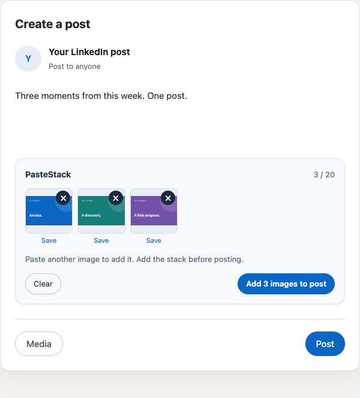

# PasteStack

Paste several clipboard images into a LinkedIn post without saving each one first.

**Cmd+V on Mac · Ctrl+V on Windows/Linux · one stack · one Add to post click.**

Each paste appends to a small tray inside the post composer. Review or remove
images, then add the entire stack to LinkedIn as separate photos in one native
multi-image post. LinkedIn handles the layout, image editing, alt text, and final
publishing.



*Preview uses a controlled test composer, not an authenticated LinkedIn account.*

## Install locally

The extension is built and ready in `dist/`. You can load it directly without
installing developer dependencies. If starting from a source checkout, build it:

```sh
npm ci
npm run build
```

1. Open `chrome://extensions` in Chrome.
2. Turn on **Developer mode**.
3. Click **Load unpacked** and select this project's **dist** folder.
4. Refresh your LinkedIn tab after saving any draft you want to keep.

Alternatively, extract `artifacts/pastestack-0.1.0.zip` and load the extracted
folder. Chrome cannot load the ZIP itself. No Chrome Web Store listing exists yet.

## Use

1. Open **Start a post** on LinkedIn, or visit its [post composer](https://www.linkedin.com/sharing/compose/).
2. Copy an actual image: for example, use **Copy image** in your browser, or
   **Cmd+Ctrl+Shift+4** for a clipboard screenshot on Mac / **Win+Shift+S** on Windows.
3. Click in the post editor and paste. A PasteStack tray appears.
4. Copy another image and paste again. Each paste appends; earlier images remain.
5. Click **Add images to post** when ready. Complete LinkedIn's image editor
   (including **Next**, if shown), and verify every native preview before posting.
6. Write your post and use LinkedIn's **Post** button when ready.

The Add button includes your image count. Repeating the exact same image is
allowed intentionally. The tray never combines photos into a single bitmap.
After handoff, use LinkedIn's own controls to remove, reorder, or edit attachments.
When adding a later batch to an existing album, LinkedIn may insert it after the
currently selected photo. Use its native reorder controls if you want a different
order; PasteStack preserves the existing photos and leaves native ordering intact.

PNG, JPEG, and GIF are supported, up to **20 images per post**, **5 MB per image**.
Counts include native attachments when their remove controls are identifiable;
LinkedIn enforces the final combined limit. Other image formats get a message
asking you to convert to PNG. Originals are never resized or recompressed.

Text-only pastes work normally. When a clipboard contains both an image file and
text/HTML, PasteStack collects the image; paste accompanying text separately.
Copying only an image URL does not fetch or attach the image.

## Why an explicit Add step?

LinkedIn already supports some direct image pastes. Repeated pastes can interact
with different post and image-editor screens. PasteStack collects a batch locally
before asking LinkedIn to upload it, so earlier images are not uploaded repeatedly.
The extension blocks the recognized Post button while an unadded stack remains;
add the images or clear the stack first.

## Lightweight by construction

- **About 13 KB** of minified JavaScript, with a hard **20 KiB** build budget.
- **Zero runtime dependencies**. TypeScript, esbuild, Playwright, and ZIP tooling
  are development tools; none ships inside the extension.
- **No background process**, startup DOM scans, timers, or clipboard polling.
- An idle tab has one paste listener. DOM observation exists only while a tray
  is open or during a bounded, three-second upload handoff.
- File references and blob URLs avoid base64 copies of original images.
  Thumbnails are downsampled to 160 pixels wide, decoded one at a time, and their
  image bitmaps are explicitly closed.
- Original and thumbnail URLs are revoked on removal, clear, successful handoff,
  composer close, or page exit. Images are not retained as clipboard history.

Image memory still depends on your files and the browser's decoder. These are
design properties and a bundle measurement, not an assertion of a measured
CPU/RAM benchmark on every computer.

## Privacy and permissions

PasteStack runs only on **https://www.linkedin.com/**. Chrome will show site-access
permission for LinkedIn because the extension needs to integrate with the composer.
It requests no clipboardRead, storage, tabs, downloads, or other extension API
permissions. It reads image files from the paste event you initiate, without
inspecting clipboard text or HTML.

There is no server, analytics, tracking, private LinkedIn API integration, or
extension-originated network request. Images live in tab memory until discarded
or handed to LinkedIn; LinkedIn's own uploader then sends them to LinkedIn.
Refreshing/navigating away or closing the composer discards a staged stack.
The extension never clicks Post or publishes on your behalf.

## Compatibility and current verification

Targets current desktop Chrome on macOS and Windows; Chromium browsers may also
work. No mobile, Safari, or Firefox support is claimed. Chrome 120 is the API
compatibility floor; use an up-to-date browser.

**Automated verification:** 31 browser tests passed locally on macOS using the
actual Manifest V3 extension loaded in Playwright's bundled Chromium. Coverage
includes a real OS clipboard paste via Cmd+V, real FileList/change-event handoff,
repeated and rapid pastes, native image preservation, lazy/modal upload inputs,
object-URL cleanup, fallback downloads, and text/comment/message exclusions.

**Live verified on 8 November 2026:** in signed-in Chrome 156 on macOS, with
LinkedIn in English, separate real Cmd+V pastes produced one two-image native
post preview. A later third paste joined the same post while retaining both
earlier photos. Plain-text paste also worked. Nothing was published. This test
caught and fixed LinkedIn's transient body-mounted upload input and its
existing-album **Edit → Add** flow; regression tests cover both.

This verifies the current `/sharing/compose` flow, not every LinkedIn experiment.
Toolbar labels currently target English. Unknown layouts should be treated as
unsupported until verified. Windows/Linux CI is configured but has not run before
this repository is pushed. See [the verification record](docs/VERIFY.md) for scope.

## If images do not attach

If the Add button reports a timeout, your stack remains available while its
composer stays open. Open LinkedIn's **Media** / **Add images** screen and retry
where the same composer remains mounted, or click **Save** beneath each preview
and select those files through LinkedIn's normal uploader. Keep the composer
open until you have saved any images you need.

The extension requires a multi-image input that accepts images. Some layouts
may not expose one until you open their media editor. It cannot confirm a
server upload; a native preview must appear before you publish. Do not click
Add again if native previews already appeared, as that can duplicate images.

If no tray appears, check that PasteStack is enabled, refresh LinkedIn after
installation, focus the post editor, and copy the image itself rather than its
address. Comments and messages are intentionally excluded. For an unsupported
layout, report the Chrome version, LinkedIn language, screen name, and the error
text without sharing private post text or account data.

## Development

Use Node 22.18+ (current Node LTS recommended) and npm.

```sh
npm ci
npx playwright install chromium
npm run check
npm run dev
```

On Linux, use `npx playwright install --with-deps chromium` if browser system
dependencies are missing. Watch mode rebuilds source; reload the extension in
`chrome://extensions` and refresh LinkedIn to use changes. Manifest/icon changes
require restarting watch mode. Tests use a temporary browser profile and never
touch your personal browser, LinkedIn account, or drafts.

For manual testing in your signed-in browser, run `npm run test:live` and open
the printed localhost URL. It provides three generated, non-sensitive images
with **Copy image** buttons. Copy them one at a time and paste into an unpublished
LinkedIn draft. This harness never publishes or accesses your account. Stop it
with Ctrl+C when finished.

```sh
npm run package
```

Packaging type-checks, tests, builds, verifies host/permission constraints, and
writes a ZIP containing only the manifest, content script, and three icons.
The ZIP is round-trip verified and its SHA-256 hash printed. CI repeats these
checks on macOS, Windows, and Linux after pushing.

All packages are exact-version pinned with a lockfile. Stable npm versions were
checked on **7 November 2026**: TypeScript 7.0.2, esbuild 0.28.2, Playwright 1.65.0,
and fflate 0.8.3 (packaging only). Node types target the supported Node 22 floor.

The adapter lives in `src/linkedin.ts`; clipboard rules are in
`src/clipboard.ts`, lifecycle handling in `src/content.ts`, and isolated tray UI
in `src/tray.ts` / `src/tray.css`. See [the implementation plan and research](docs/PLAN.md)
and [release verification](docs/VERIFY.md).

No remote is configured. Once a GitHub repository URL is available, add it as
`origin` and push `main`; the staged commits are already in local Git history.

PasteStack is an independent project, not affiliated with LinkedIn.
